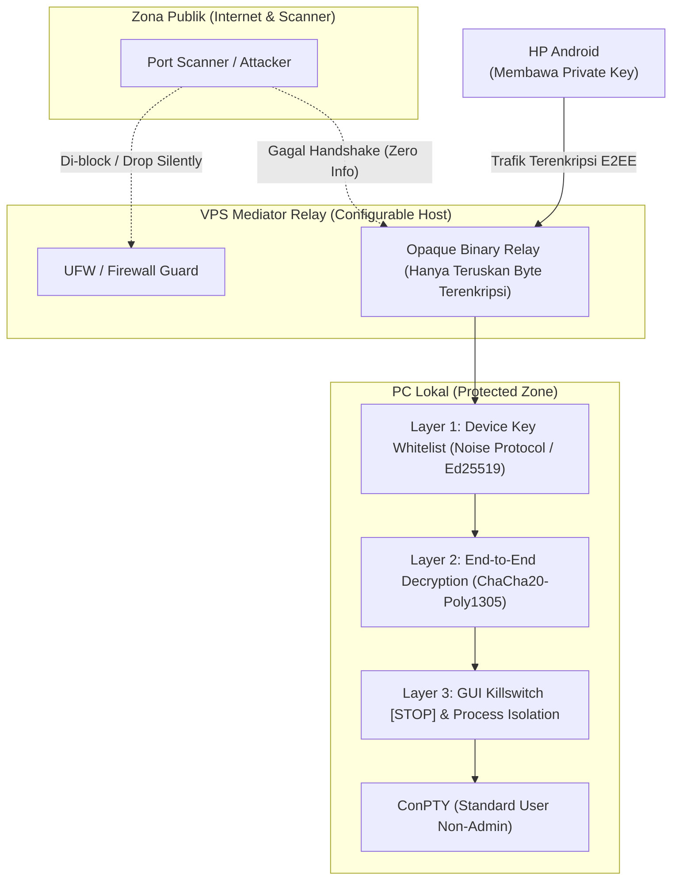
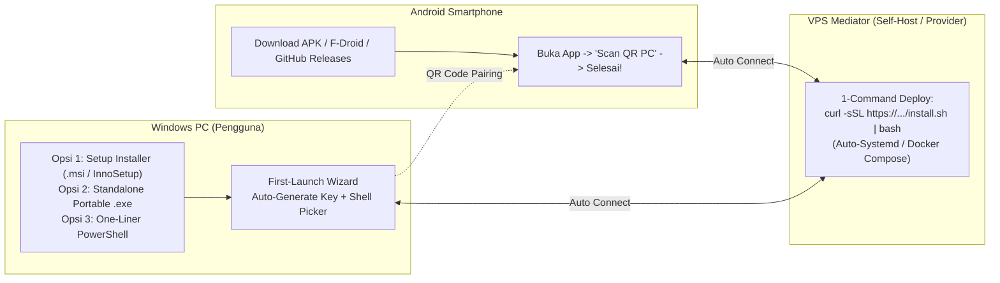

# PCTunnel: Arsitektur & Rencana Implementasi (Security Hardened & Public Distribution Ready)

Dokumen ini memuat arsitektur sistem **PCTunnel** dengan dua fokus utama:
1. **Zero-Trust Security**: Menjamin PC lokal tidak dapat disusupi (*infiltrated*) oleh siapapun dari internet, bahkan jika server relay disusupi.
2. **Zero-Friction User Experience & Distribution**: Memastikan pengguna umum dapat memasang dan memakai software ini dengan *minimum steps to do* (1-Click Installer untuk PC, 1-Command deploy untuk relay VPS, dan Scan QR instan untuk Android).

---

## 1. Zero-Trust Security Architecture (Jaminan Keamanan PC)

Karena PC ini membuka akses terminal ke luar melalui relay, sistem menerapkan prinsip pertahanan berlapis (**Defense-in-Depth**):



### 5 Pilar Keamanan Anti-Penyusupan:

1. **End-to-End Encryption (E2EE) via Noise Protocol (`Noise_IK`)**:
   - Stream terminal (keystroke, output layar, resize, heartbeat) dienkripsi langsung dari HP ke PC menggunakan **Noise Protocol Framework** (`Noise_IK_25519_ChaChaPoly_BLAKE2s`).
   - Server relay hanya bertindak sebagai *dumb binary router* (tidak memiliki session key, tidak dapat membaca data maupun menyuntikkan payload).
2. **Device Whitelisting (Kriptografis, Zero Password)**:
   - Tidak ada login username/password yang bisa di-*brute-force*.
   - Menggunakan pasangan kunci **Ed25519 / X25519**.
   - Pairing dilakukan sekali saja via pemindaian **QR Code** dari layar PC ke kamera HP.
   - PC Daemon **hanya menerima koneksi dari Public Key HP yang terdaftar**. Paket dari public key tak dikenal diabaikan seketika (*drop silently*).
3. **Port Stealth & Resilient Protocol**:
   - Relay tidak membuka port terbuka tanpa kriptografi.
   - Frame protokol mendukung **Heartbeat (Ping/Pong)** tiap 15 detik dan **Session Resumption Token** agar sesi tidak terputus saat beralih antara 4G dan WiFi.
   - Mendukung frame khusus **Terminal Resize (`cols` x `rows`)** untuk adaptasi keyboard virtual di smartphone.
4. **Isolasi Proses & Privilese Terbatas**:
   - Daemon dan sesi terminal berjalan dengan hak akses pengguna biasa (**Standard User**), **bukan Administrator**.
   - ConPTY diisolasi dalam job object Windows sehingga proses tidak dapat mengeksekusi eskalasi hak istimewa di luar sesi user.
   - MCP Server strictly di-bind pada **`127.0.0.1` (loopback lokal)**, tidak bisa diakses sama sekali dari jaringan luar.
5. **Hardware Killswitch di GUI**:
   - Tombol **[ STOP ]** pada aplikasi PC bertindak sebagai *Killswitch* instan:
     - Memutus koneksi soket tunnel seketika.
     - Membunuh (*kill*) semua background PTY worker yang aktif.
     - Menghapus session token dari memori.
     - Status berubah menjadi offline total.

---

## 2. Minimum-Step Distribution & Installer Architecture

Agar software ini dapat dipublikasi secara luas dan dipakai dengan mudah oleh pengguna awam tanpa konfigurasi rumit, disediakan jalur instalasi otomatis untuk ketiga komponen:



### A. Windows PC: Minimum Steps to Run
1. **Pilihan Distribusi**:
   - **Standalone Portable `.exe`**: Pengguna hanya mendownload 1 file `.exe` tunggal (Rust native, tanpa runtime Node/Python/Java), dobel klik, langsung jalan.
   - **One-Liner Install (PowerShell)**:
     ```powershell
     irm https://pctunnel.dev/install.ps1 | iex
     ```
   - **Windows Installer (`.msi` / Inno Setup)**: Membuat shortcut desktop, Start Menu, dan opsi auto-start di System Tray saat Windows booting.
2. **First-Launch Wizard (Zero Manual Config)**:
   - Saat aplikasi pertama dibuka:
     - Otomatis membuat pasangan kunci kriptografi (X25519/Ed25519).
     - Otomatis mendeteksi shell terbaik yang terpasang di PC (PowerShell 7 / PowerShell 5.1 / Git Bash / CMD).
     - Menampilkan jendela QR Code siap scan.

### B. Android App: Zero Manual Typing
1. **Distribusi**: File APK release di GitHub / F-Droid / Google Play.
2. **Pairing 3 Detik**:
   - Buka aplikasi -> Izinkan kamera -> Scan QR Code di layar PC.
   - Public Key PC, Relay Address, dan Pairing Token langsung tersimpan.
   - Terminal langsung terbuka dan siap menerima input!

### C. VPS Mediator: 1-Command Self-Hosting
Bagi pengguna atau komunitas yang ingin menjalankan server relay sendiri:
1. **One-Liner Install Script**:
   ```bash
   curl -sSL https://raw.githubusercontent.com/pctunnel/pctunnel/main/scripts/deploy-relay.sh | bash
   ```
2. **Docker Ready**:
   ```bash
   docker run -d --name pctunnel-relay -p 8080:8080 -p 8443:8443 pctunnel/relay:latest
   ```
3. Otomatis konfigurasi firewall (UFW), SSL/TLS (jika menggunakan domain), dan systemd service auto-restart.

---

## 3. Desain Protokol & Framing Data

Komunikasi antara HP dan PC melalui relay dibungkus dalam format frame biner terenkripsi:

| Frame Type (1 Byte) | Payload Description |
| :--- | :--- |
| `0x01` (Handshake) | Inisialisasi Noise Protocol (`Noise_IK`) |
| `0x02` (Terminal Input) | Keystroke dari HP ke PC (Terenkripsi) |
| `0x03` (Terminal Output) | ANSI/VT100 byte stream dari PC ke HP (Terenkripsi) |
| `0x04` (Resize Window) | Sinyal `cols` (u16) & `rows` (u16) saat layar HP berputar/keyboard aktif |
| `0x05` (Heartbeat/KeepAlive)| Ping/Pong interval 15s untuk menjaga NAT seluler |
| `0x06` (Session Reconnect) | Token resume saat koneksi HP berganti antara 4G dan WiFi |
| `0x07` (Disconnect/Kill) | Sinyal terminasi bersih |

---

## 4. Komponen Sistem Terpadu

### A. Windows Desktop GUI Wrapper (`pctunnel-app.exe`)
- **Bahasa & UI**: Rust + GUI Framework ringan (Slint / Iced) -> Binary ukuran kecil (< 15 MB), konsumsi RAM sangat rendah (< 20 MB).
- **Fitur Utama**:
  - Tombol **[ START ]** & **[ STOP (Killswitch) ]**.
  - Panel **Authorized Devices**: Daftar HP yang terotorisasi dengan opsi cabut izin (*revoke*) 1 klik.
  - **Live Connection Monitor**: Real-time status, latency, dan fingerprint HP yang sedang terhubung.
  - Setup Wizard & QR Code Generator.
  - Opsi **Auto-Lock / Inactivity Timeout**.

### B. Core Terminal Daemon & ConPTY (`pctunnel-core`)
- Memakai ConPTY resmi Windows via Win32 API (`CreatePseudoConsole`).
- Handler sinyal resize jendela dan virtual terminal processing.
- Multi-client guard: Hanya 1 active interactive session diizinkan dalam satu waktu demi keamanan.

### C. VPS Mediator: Blind Rendezvous Relay (Tanpa Akun SSH, 100% Aman untuk Publik)
Beralih dari SSH tunnel tradisional ke model **Blind Rendezvous Relay (Opaque Session Bridge)**:
- **Zero Shell / Zero VPS Access**: Relay sama sekali tidak membuka port SSH dan tidak memiliki sistem user Linux. Relay hanya binary service mini yang bertindak sebagai "jembatan pipa" asinkronus (`pipe A <-> B`).
- **Multi-Tenant Publik Ready**: 
  - 1 VPS tunggal dapat melayani ribuan pengguna sekaligus tanpa takut tabrakan port (*no port collision*).
  - Semua koneksi masuk lewat satu port HTTPS/WSS (misalnya port `443`), sehingga dijamin **lolos dari firewall kantor, kampus, dan provider seluler** yang sering memblokir port SSH custom.
- **Mekanisme Rendezvous (Matching Room)**:
  - PC terhubung ke: `wss://relay.domain.com/v1/tunnel?room=<ROOM_ID>&role=host`
  - Android scan QR lalu terhubung ke: `wss://relay.domain.com/v1/tunnel?room=<ROOM_ID>&role=client`
  - Server relay hanya mencocokkan `ROOM_ID` dan menyambungkan stream biner kedua pihak (`tokio::io::copy_bidirectional`).
  - Begitu tersambung, handshake E2EE (Noise Protocol) langsung berjalan antardua perangkat. VPS tidak memiliki kunci dekripsi.
- **Proteksi Server VPS**:
  - Rate limiting per IP untuk mencegah abuse/DDoS.
  - Room ID kadaluarsa otomatis jika tidak ada aktivitas.
  - Binary relay berjalan di dalam sandbox container unprivileged (*non-root*).

### D. MCP Server untuk LLM Agents (`pctunnel-mcp`)
- Terikat strictly pada `127.0.0.1:4040` (hanya bisa diakses secara lokal oleh Claude / Antigravity).
- Menyediakan tool: `notify_user(title, message, priority)` dan `get_tunnel_status()`.

### E. Android Client App (`pctunnel-android`)
- Kotlin + Jetpack Compose.
- Terminal engine menggunakan Termux Terminal View Core untuk dukungan VT100/Xterm, ANSI 256 color, dan Unicode yang stabil.
- On-screen touch bar (`Ctrl`, `Alt`, `Esc`, `Tab`, panah, `PgUp`, `PgDn`).
- Integrasi push notification untuk notifikasi agent.

---

## 5. Tahapan Eksekusi Bertahap

| Fase | Tahap | Deliverable |
| :--- | :--- | :--- |
| **Fase 1** | **Spesifikasi Protokol & Relay Mediator** | Engine relay biner asinkronus + Script 1-Command Deploy VPS (`deploy-relay.sh` & Dockerfile). |
| **Fase 2** | **Core ConPTY Daemon & E2EE Crypto Engine** | Engine ConPTY Windows dengan Noise Protocol (`Noise_IK`), frame resize, dan heartbeat. |
| **Fase 3** | **Windows GUI App & Installer Builder** | Aplikasi desktop Rust (Slint/Iced), QR Code Pairing, Killswitch, dan skrip installer Windows (`install.ps1` & Inno Setup config). |
| **Fase 4** | **MCP Server (Local Loopback)** | Server MCP `127.0.0.1` untuk notifikasi agen AI lokal ke HP. |
| **Fase 5** | **Android App (UI, Terminal Engine, QR Scanner)** | Aplikasi Android dengan Jetpack Compose + Termux view, scanner QR, dan push notification listener. |
| **Fase 6** | **Security Verification & Release Packaging** | Uji penetrasi (MITM VPS simulation, rogue key rejection, network switch reconnect, killswitch instant drop) dan automated GitHub Release workflow. |
